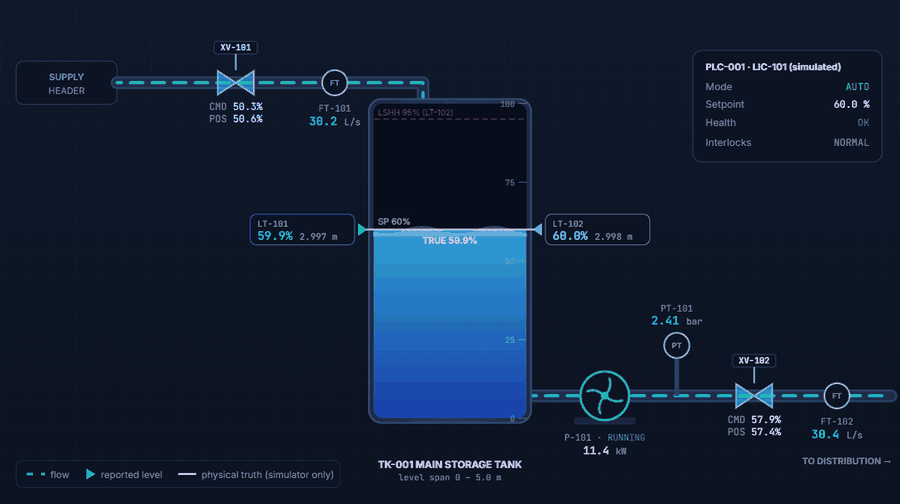
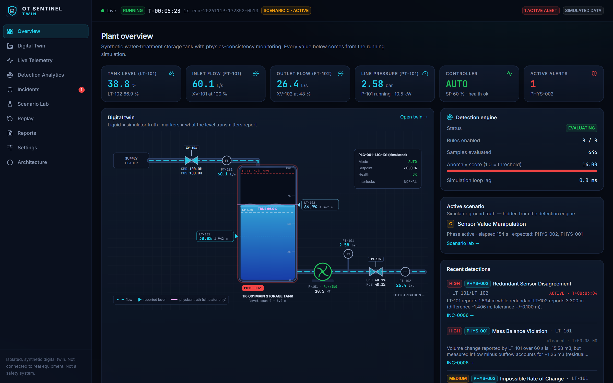
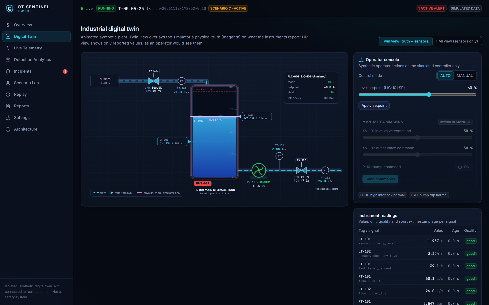
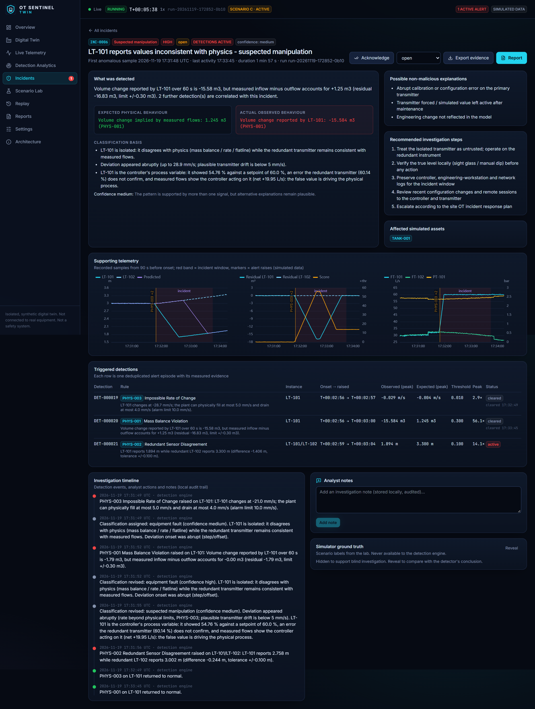
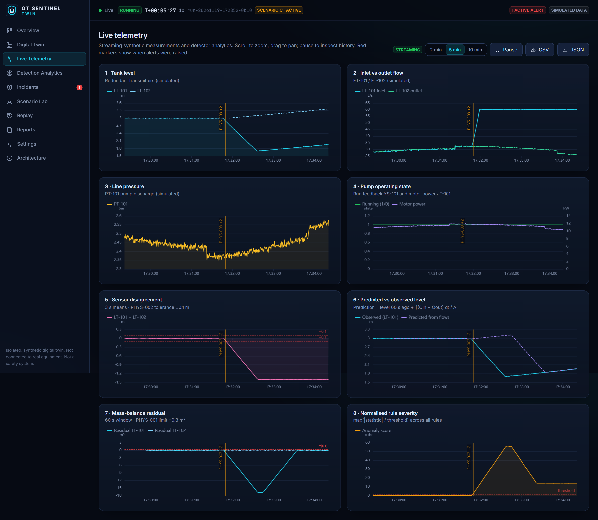
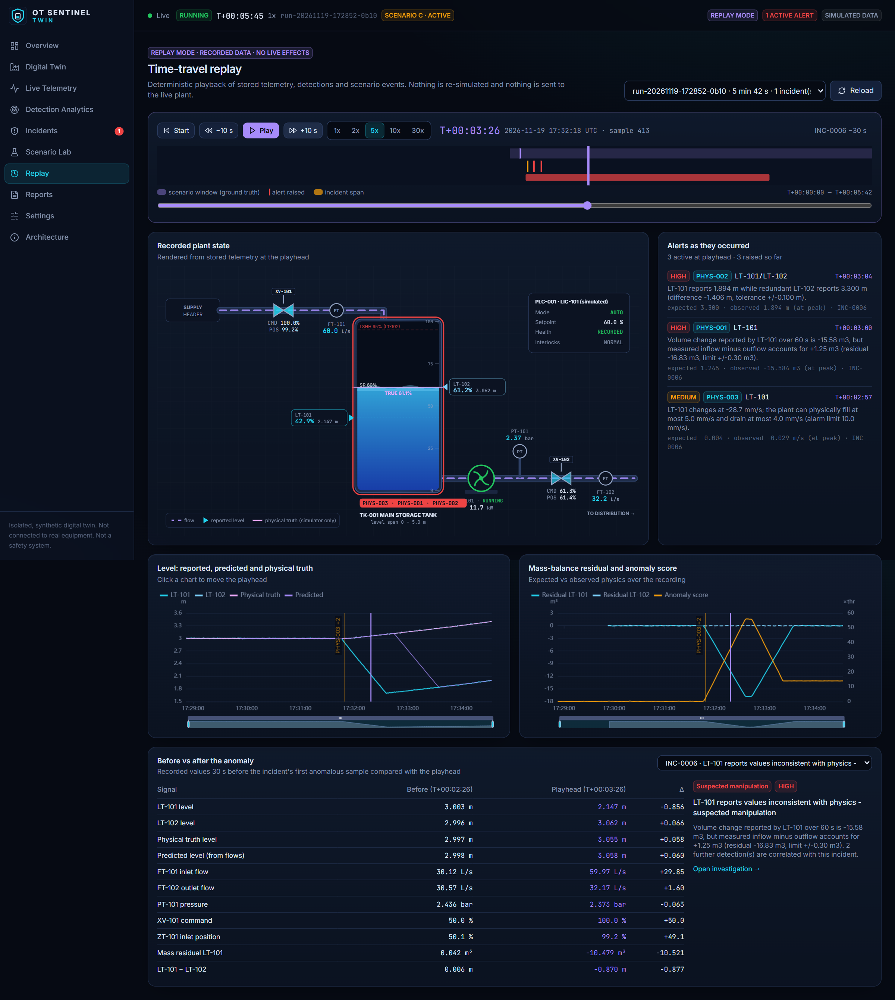
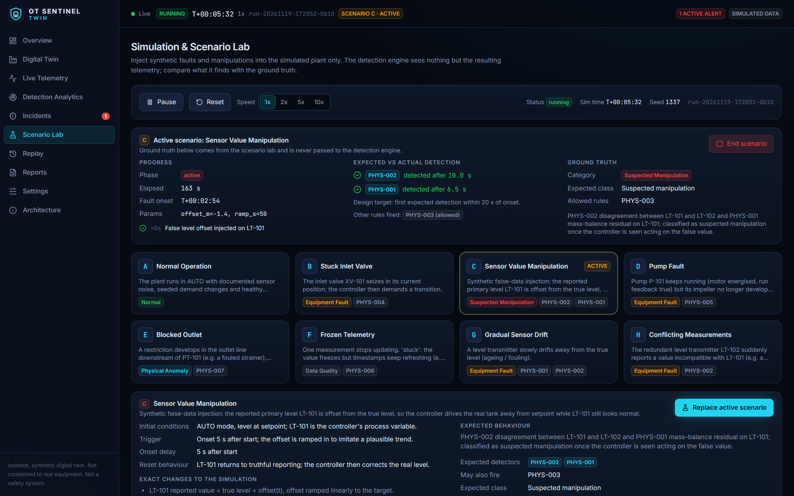
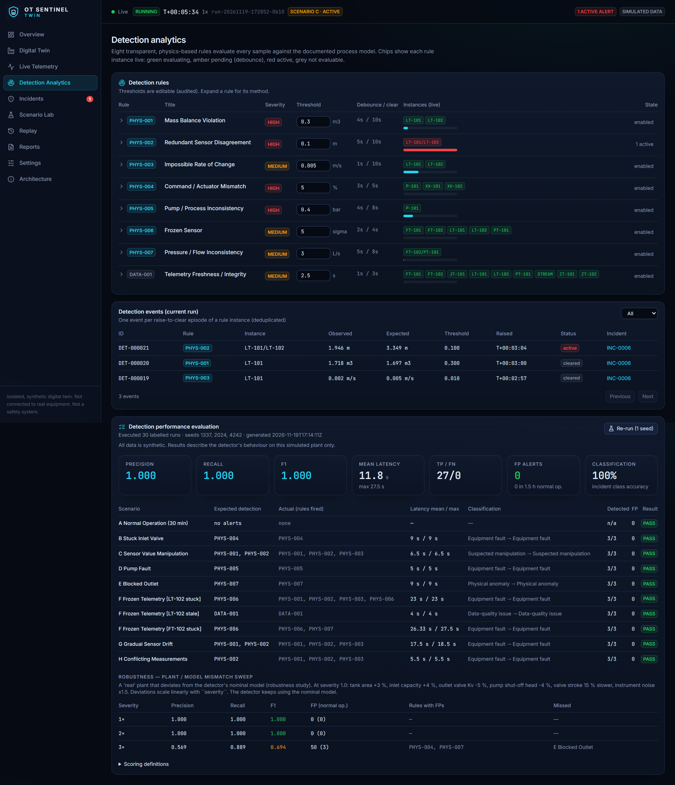
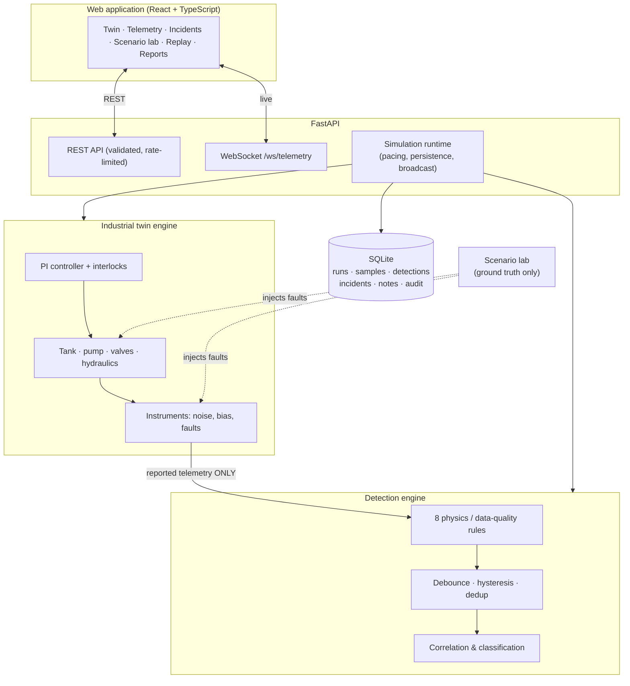
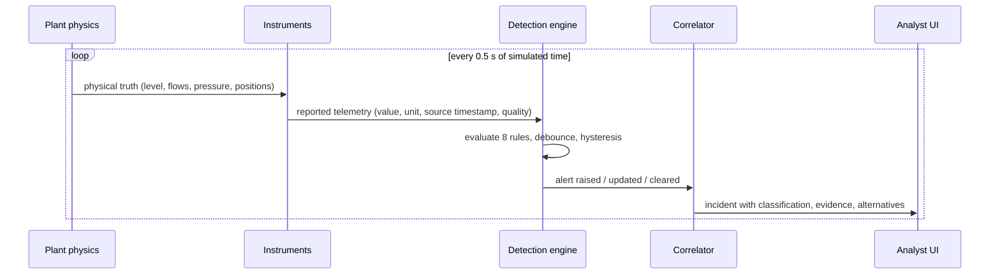

<div align="center">


# OT Sentinel Twin

**See the Process. Detect the Impossible.**

An open-source OT/ICS security lab that checks whether industrial telemetry is *physically possible* —
an animated digital twin, eight explainable physics-based detection rules, an incident workspace and deterministic replay.


</div>

> **Every signal can look normal on its own while the process as a whole is impossible.**
> A tank level that drops while measured inflow exceeds outflow, a pump that reports *running* without
> developing head, a level transmitter that holds the exact same value while the plant fills. Signature-based
> and network-only monitoring can miss all of these. OT Sentinel Twin checks the physics.



*Recorded from the running app: the primary level transmitter LT-101 starts reporting a falling level; the controller
reacts by opening the inlet valve while the real tank (magenta truth line, confirmed by LT-102) keeps filling.
Mass-balance and redundancy rules flag the tank within seconds.*



*Scenario C (synthetic false-data injection): LT-101 — the controller's level input — reports 39 % while the
simulator's physical truth (magenta) and the redundant transmitter LT-102 read 67 %. The controller has opened the
inlet valve to 100 % because it trusts the falsified value. The mass-balance rule shows why this is impossible:
LT-101 reported −15.6 m³ of volume change while measured flows added +1.25 m³.*

> [!IMPORTANT]
> This is an **isolated, educational and defensive** project. All assets, telemetry and events are synthetic.
> It does not connect to PLCs, gateways or industrial networks, implements no industrial protocol, and is
> **not a certified safety system** or a replacement for real operational protections.

---

## Why this is interesting

| Traditional OT monitoring asks… | OT Sentinel Twin asks… |
|---|---|
| Does this packet match a known-bad signature? | Is this measurement consistent with mass conservation? |
| Is this value inside its alarm limits? | Could the tank physically change level this fast? |
| Is this device talking to the right host? | Does the pump's pressure match its characteristic curve at this flow? |
| Did the value change? | Should it have changed, given what independent instruments show? |

Each detection is **explainable**: it states the observed value, the value physics predicts, the threshold, the
window and the evidence — and an incident is classified as a *physical anomaly*, *equipment fault*, *data-quality
issue* or *suspected manipulation* only by a documented decision procedure, always with non-malicious alternatives.

## Features (implemented and verified)

- **Physics-based digital twin** — tank mass balance with exact overflow / dry-run bookkeeping, centrifugal pump curve,
  rate-limited valve actuators, closed-form hydraulics, PI level controller with feed-forward and independent
  interlocks, seeded sensor noise/bias/quantisation. Conservation of mass verified to ~1e-12 m³ by tests.
- **Eight detection rules** — mass balance, redundant-sensor disagreement, impossible rate of change,
  command/actuator mismatch, pump/process inconsistency, frozen sensor, pressure/flow inconsistency, telemetry
  freshness. Debounce, hysteresis, deduplication and recovery are uniform across rules.
- **Strict separation** — the detector sees only reported telemetry plus static engineering data. Scenario labels and
  physical truth are never passed to it (enforced by a test).
- **Scenario lab** — eight synthetic scenarios (A–H) with documented initial conditions, triggers, exact changes,
  ground truth, expected detectors, target latency and reset behaviour; live expected-vs-actual comparison.
- **Incident investigation** — correlation into incidents, evidence-based classification with confidence and
  rationale, expected-vs-observed behaviour, supporting telemetry, timeline, notes, status workflow, evidence export,
  local audit trail.
- **Time-travel replay** — deterministic playback of recorded runs (never re-simulated) with alert markers,
  scenario windows, synchronised twin and before/after comparison.
- **Reports** — Markdown and JSON incident reports generated from stored evidence; print / save as PDF via the browser.
- **Measured evaluation** — labelled-scenario harness with precision, recall, F1, latency, a coverage matrix and a
  plant/model-mismatch robustness sweep. Results are generated, not written by hand.
- **Hardened delivery** — Docker Compose (non-root, read-only root FS, all capabilities dropped, localhost-only ports),
  restrictive CORS and WebSocket origin checks, body-size and rate limits, optional API token, read-only demo mode,
  CI with lint/type/test/build/audit/CodeQL and SHA-pinned actions.

## Screenshots

All screenshots were captured from the running application by
[`frontend/scripts/capture-screenshots.mjs`](frontend/scripts/capture-screenshots.mjs).

| | |
|---|---|
|  **Digital twin** — truth vs. reported values, operator console, instrument quality |  **Incident workspace** — classification basis, alternatives, evidence charts, timeline |
|  **Live telemetry** — eight synchronised charts with thresholds and alert markers |  **Replay** — recorded playback, alert markers, before/after comparison |
|  **Scenario lab** — ground truth and expected-vs-actual detection |  **Detection analytics** — live rule states, evaluation, robustness sweep |

## Architecture





More detail: [docs/ARCHITECTURE.md](docs/ARCHITECTURE.md).

## Quick start

### Docker (recommended)

```bash
git clone https://github.com/<your-account>/ot-sentinel-twin.git
cd ot-sentinel-twin
docker compose up --build
```

Open **http://127.0.0.1:8080**. The API and OpenAPI docs are at http://127.0.0.1:8000/api/docs. Both ports are
bound to localhost only. If 8080 or 8000 is taken, set `OTST_WEB_PORT` / `OTST_API_PORT`
(e.g. `OTST_WEB_PORT=8088 docker compose up --build`).

Read-only demo storyline (scripted scenarios on a loop, all state-changing calls disabled):

```bash
docker compose -f docker-compose.yml -f docker-compose.demo.yml up --build
```

### Local development

Requirements: Python 3.12+, Node.js 22+.

```bash
# backend
cd backend
python -m venv .venv && . .venv/bin/activate      # Windows: .venv\Scripts\activate
pip install -e ".[dev]"
uvicorn app.main:create_app --factory --host 127.0.0.1 --port 8000

# frontend (second terminal)
cd frontend
npm ci
npm run dev                                       # http://127.0.0.1:5173 (proxies /api and /ws)
```

Optional single-process mode: build the frontend (`npm run build`) and start the backend with
`OTST_FRONTEND_DIST=../frontend/dist` to serve the UI from port 8000.

### A two-minute tour

1. **Scenario Lab** → set speed to **5x** → select **C Sensor Value Manipulation** → **Start scenario**.
2. Watch **Expected vs actual detection**: PHYS-002 and PHYS-001 fire within seconds of onset.
3. **Digital Twin** → the magenta truth line rises while LT-101 falls; XV-101 is driven fully open.
4. **Incidents** → open the incident: classification *suspected manipulation* (medium confidence), the evidence
   behind it, and the non-malicious explanations that remain possible. Add a note, acknowledge it.
5. **Replay** → pick the run, jump to *INC −30 s*, press **Play** and compare before/after.
6. **Reports** → download the Markdown or JSON report.

## Simulation scenarios

| Code | Scenario | What changes (simulation only) | Expected detection | Classification |
|---|---|---|---|---|
| A | Normal operation | nothing — labelled normal window | none | — |
| B | Stuck inlet valve | XV-101 seizes; operator raises setpoint +10 % | PHYS-004 | equipment fault |
| C | Sensor value manipulation | LT-101 offset −1.4 m ramped over 50 s (false-data injection) | PHYS-002, PHYS-001 | suspected manipulation |
| D | Pump fault | P-101 keeps running but delivers 15 % of its head | PHYS-005 | equipment fault |
| E | Blocked outlet | 75 % restriction downstream of PT-101 | PHYS-007 | physical anomaly |
| F | Frozen telemetry | a transmitter freezes (`stuck` = fresh timestamps, `stale` = old timestamps) | PHYS-006 / DATA-001 | equipment fault / data quality |
| G | Gradual sensor drift | LT-102 drifts +2 mm/s | PHYS-001, PHYS-002 | equipment fault |
| H | Conflicting measurements | LT-102 steps +0.8 m | PHYS-002 | equipment fault |

Full definitions, timelines and parameters: [docs/SCENARIOS.md](docs/SCENARIOS.md).

## Detection methodology

| Rule | What it checks | Default threshold |
|---|---|---|
| PHYS-001 Mass balance | A·Δh from each level transmitter vs. ∫(FT-101 − FT-102)dt over 60 s | ±0.30 m³ |
| PHYS-002 Sensor disagreement | 3 s means of LT-101 vs LT-102 | ±0.10 m |
| PHYS-003 Impossible rate of change | 5 s level slope vs. Qmax/A (fill 5.0 mm/s, drain 4.0 mm/s) | 1.25 × limit + 5 mm/s |
| PHYS-004 Command/actuator mismatch | valve feedback vs. a healthy stroking envelope (rated speed ±30 %); pump command vs. run feedback | 5 % / 10 s |
| PHYS-005 Pump/process inconsistency | measured ΔP vs. pump curve P0 − kQ² at measured flow; stopped pump with powered flow | 0.40 bar |
| PHYS-006 Frozen sensor | exact flatline while independent signals predict change | 5 σ of instrument noise |
| PHYS-007 Pressure/flow inconsistency | FT-102 vs. valve equation Kv·x·√(P − Pback) | max(3 L/s, 15 %) |
| DATA-001 Telemetry freshness | stale / missing / out-of-order source timestamps, stream gaps | 2.5 s age |

Rules suspend themselves when their inputs are not fresh (data-quality findings never masquerade as physics), and
near tank boundaries where unmeasured flows are expected. Thresholds are derived from the documented instrument
noise — see [docs/DETECTION_ENGINE.md](docs/DETECTION_ENGINE.md) and [docs/PHYSICS_MODEL.md](docs/PHYSICS_MODEL.md).

### Measured results

Executed by [`scripts/run_evaluation.py`](scripts/run_evaluation.py) — 30 labelled runs (3 seeds × 10 cases including
1.5 h of normal operation). Full matrix and definitions: [docs/EVALUATION_RESULTS.md](docs/EVALUATION_RESULTS.md).

| Metric | Nominal model | Plant/model mismatch 2× | Mismatch 3× |
|---|---|---|---|
| Recall (scenario level) | 1.000 | 1.000 | 0.889 |
| Precision (alert level) | 1.000 | 1.000 | 0.569 |
| False positives in normal operation | 0 in 1.5 h | 0 | 3 |
| Mean / max detection latency | 11.8 s / 27.5 s | — | — |

**Read these numbers honestly.** The nominal detector uses the same documented model that generates the data, so
perfect scores mainly show that the rules, thresholds and lifecycle logic are consistent. The mismatch sweep is the
more informative result: detection stays clean while the real plant deviates from the model by up to ~10 % in valve
Kv and pump head, 30 % in actuator speed and 2× in instrument noise; at 3× the pressure/flow and actuator rules start
to false-alarm and the blocked-outlet scenario is missed. A real deployment would need model calibration.

## Example output

```text
INC-0001 · Suspected security-related manipulation · confidence: medium
LT-101 reports values inconsistent with physics - suspected manipulation

PHYS-001  Volume change reported by LT-101 over 60 s is -15.58 m3, but measured inflow minus outflow
          accounts for +1.25 m3 (residual -16.83 m3, limit +/-0.30 m3).
PHYS-002  LT-101 reports 1.894 m while redundant LT-102 reports 3.300 m (difference -1.406 m, tolerance +/-0.100 m).

Classification basis
- LT-101 is isolated: it disagrees with physics while the redundant transmitter remains consistent with measured flows.
- Deviation appeared abruptly (up to 28.9 mm/s; plausible transmitter drift is below 5 mm/s).
- LT-101 is the controller's process variable ... measured flows show the controller acting on it.
Possible non-malicious explanations: abrupt calibration error · forced/simulated value left active · unmodelled change
```

## Testing

```bash
cd backend && pytest -q                 # 65 tests: physics, every rule, lifecycle, API, security, replay, reports
cd backend && ruff check . && mypy app
cd frontend && npm test                 # 23 component/interaction tests (Vitest + Testing Library)
cd frontend && npm run lint && npm run typecheck && npm run build
cd frontend && npx playwright test      # 4 end-to-end journeys against the real backend
python scripts/run_evaluation.py        # regenerate detection metrics
```

## Repository layout

```text
backend/app/
  simulation/   plant physics, sensors, controller, engine          detection/  rules, lifecycle, correlation
  scenarios/    catalogue A-H and scenario manager                  evaluation/ labelled-scenario harness
  api/          REST + WebSocket                                     services/   live runtime, WebSocket hub
  repositories/ SQL access (SQLite, portable)                       reports/    report generator
frontend/src/   pages, components (SVG twin, charts), hooks, services, tests
datasets/synthetic/  labelled CSV datasets + evaluation results     scripts/  evaluation and dataset generators
docs/           architecture, physics, detection, scenarios, evaluation, API, deployment, threat model, launch
```

## Security & limitations

- Synthetic only: no real equipment, protocols, credentials or networks. Scenario events are labelled synthetic.
- Not a safety system. Thresholds are calibrated to this twin's noise model and are not transferable without
  re-validation.
- A coordinated attacker who falsifies redundant transmitters *and* flow meters consistently could evade
  physics-consistency checks; see [docs/THREAT_MODEL.md](docs/THREAT_MODEL.md).
- Local mode has no user authentication (analyst names are self-declared). Public deployments should use
  `OTST_READ_ONLY=true` or `OTST_API_TOKEN`; see [docs/DEPLOYMENT.md](docs/DEPLOYMENT.md) and [SECURITY.md](SECURITY.md).

### Not implemented (documented future work)

- Optional AI investigation assistant (deliberately left out of v0.1.0; the platform needs no external model).
- Server-side PDF export (use the browser's *Print / Save as PDF* on the Reports page).
- Static GitHub Pages demo with client-side playback.
- PostgreSQL is supported by design (SQLAlchemy, portable schema) but only SQLite is tested.

## Roadmap

- Multi-tank plant with parallel pumps and a chemical-dosing loop
- Model calibration from recorded normal operation (closing the mismatch gap)
- Kalman-filter / observer-based residuals alongside the rule set
- Optional local-LLM assistant that summarises stored evidence (never controls the plant)
- Static, prerecorded demo build for GitHub Pages

## Contributing

Contributions are welcome — please read [CONTRIBUTING.md](CONTRIBUTING.md). Security issues: see [SECURITY.md](SECURITY.md).

## License

[Apache-2.0](LICENSE)
