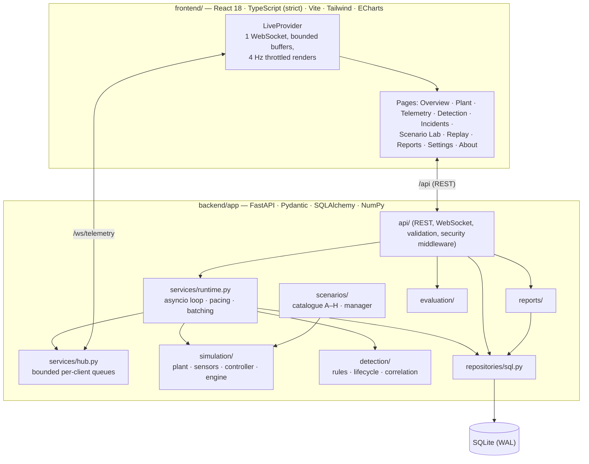

# Architecture

## Separation of concerns

| Layer | Responsibility | Never does |
|---|---|---|
| `simulation/` | deterministic physics, instruments, controller; pure functions of (config, seed, timeline) | I/O, sleeping, knowledge of detection |
| `scenarios/` | apply/revert synthetic faults, record ground-truth events | expose labels to detection |
| `detection/` | rules on reported telemetry + static `ProcessModel`; alert lifecycle; correlation | read physical truth or scenario state |
| `services/runtime.py` | wall-clock pacing (1x–10x), batching writes, broadcasting | contain physics or rule logic |
| `api/` | validation, authorization guards, error format, pagination | contain business logic beyond orchestration |
| `repositories/` | all SQL (parameterised via SQLAlchemy) | business logic |
| `frontend/` | visualisation and analyst workflows | compute detections or invent data |

## Data flow per sample

1. Scenario hooks (ground truth) run, then the controller computes commands from the **previous** reported sample.
2. Physics integrates 5 × 0.1 s; instruments produce a `TelemetrySample` (values, units, source timestamps, quality).
3. `DetectionEngine.process(sample)` → alert changes + analytics; `IncidentCorrelator.process(...)` → incident changes.
4. The runtime appends the payload (reported signals + physical truth + analytics, for twin view and replay) to a
   bounded in-memory buffer, queues it for persistence (batched once per second in a worker thread) and publishes it
   to WebSocket clients.

## Concurrency model

* One asyncio event loop owns the engine. All endpoints that touch live engine state are `async` (run on the loop).
* Read-only database endpoints are synchronous (thread pool). Pending-write buffers are swapped under a lock, so any
  thread can request a flush; batch writes are serialised by a second lock.
* `Hub.publish` is thread-safe (`call_soon_threadsafe`); each client has a bounded queue (512 messages, drop-oldest).

## Storage

| Table | Purpose |
|---|---|
| `simulation_configurations` | validated plant configuration snapshots |
| `simulation_runs` | one row per run (seed, epoch, status, counts, truncation) |
| `assets` | synthetic asset register |
| `telemetry_samples` | wide row per scan: indexed numeric columns for charts/replay + full JSON payload |
| `scenario_events` | ground-truth timeline (started / fault_onset / action / stopped) |
| `detection_rules` | rule metadata + persisted configuration |
| `detection_events` | alert episodes with evidence and peak values |
| `incidents` | classification, rationale, alternatives, timeline; analyst status kept separate from detector updates |
| `investigation_notes` | analyst notes |
| `audit_events` | operator/analyst actions (local audit trail) |

Indexes: `(run_id, seq)` unique, `(run_id, sim_time_s)`, `(run_id, raised_t)`. Retention: the newest
`OTST_RETENTION_RUNS` runs are kept; samples per run are capped at `OTST_MAX_SAMPLES_PER_RUN` (oldest trimmed,
run marked `truncated`). The repository only depends on a SQLAlchemy `sessionmaker`, so PostgreSQL is possible via
`OTST_DATABASE_URL` (untested in v0.1.0).

## Frontend performance

* One shared WebSocket; samples accumulate in refs and React state is flushed at most every 250 ms.
* Live buffer capped at 1 200 samples (10 min at 2 Hz); alerts capped at 300.
* ECharts is tree-shaken (line charts + 6 components), updates with `replaceMerge` and LTTB sampling; animations off.
* Replay loads columnar data (≤ 20 000 samples per request) and advances a playhead at 8 Hz without refetching.
