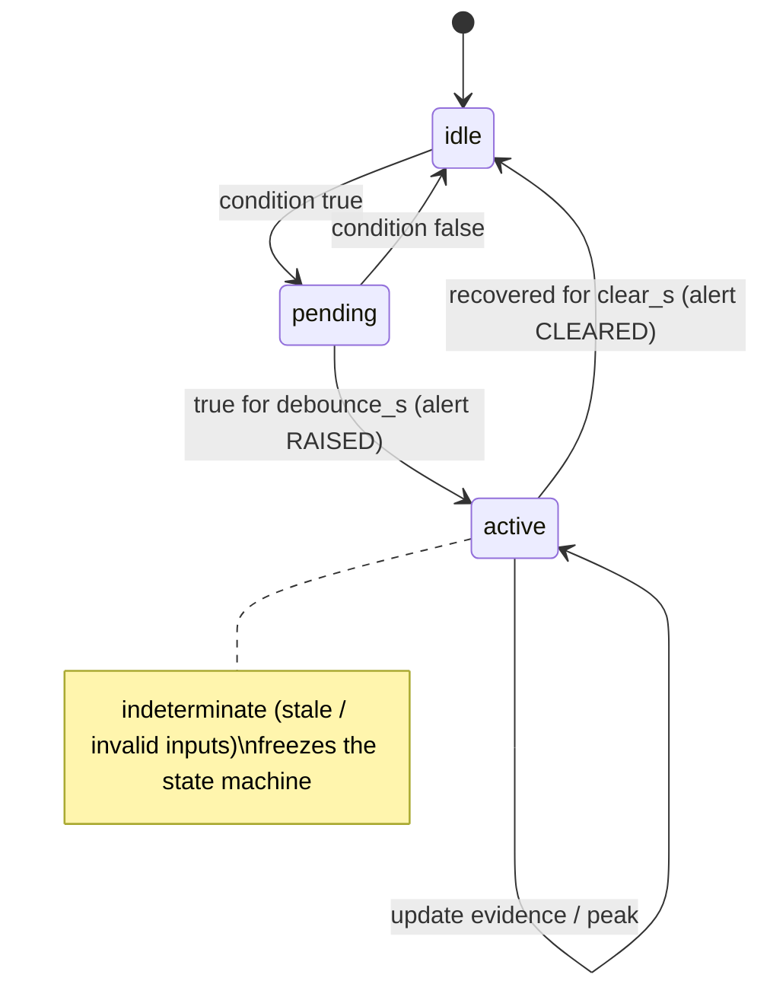

# Detection Engine

Source: [`backend/app/detection/`](../backend/app/detection). The engine evaluates every telemetry sample (2 Hz of
simulated time) against static engineering knowledge of the plant (`ProcessModel`: tank geometry, valve and pump
characteristics, instrument noise specifications). **It never receives scenario identifiers, fault flags or physical
truth** — `DetectionEngine.process(sample)` takes only a `TelemetrySample`, and a test asserts that this type carries
nothing else.

## Alert lifecycle (all rules)



* **Debounce** – a condition must persist for `debounce_s` before an alert is raised. The alert keeps both the
  *first anomalous sample* (`first_seen`) and the raise time.
* **Hysteresis** – an active alert clears only after the statistic stays below `clear_ratio × threshold` for
  `clear_s`.
* **Deduplication** – one alert per raise→clear episode of a rule instance (e.g. `PHYS-001/LT-101`).
* **Indeterminate inputs** – rules return "not evaluable" when inputs are stale, missing or bad-quality (reported
  separately by DATA-001) or near tank boundaries where unmeasured flows are expected.
* **Evidence** – onset, raise, peak, periodic updates and clear snapshots with observed/expected values and the
  relevant measurements. Alerts keep their peak evidence and explanation so reports describe the strongest evidence,
  not the last sample before recovery.
* A monotonic evaluation clock keeps timers correct even if a faulty stream delivers timestamps out of order.

Thresholds, debounce, clear time, hysteresis and enable state are editable per rule (UI or
`PUT /api/detections/rules/{id}`), persisted and audited.

## Rules

### PHYS-001 Mass balance violation — per level transmitter

```text
C(t)      = ∫ (FT-101 − FT-102)/1000 dt            (trapezoidal, over the last 60 s)
observed  = A · (mean₃ₛ(L_end) − mean₃ₛ(L_start))
expected  = mean₃ₛ(C_end) − mean₃ₛ(C_start)        (same averaging aligns level and flow)
residual  = observed − expected                    alert if |residual| > 0.30 m³ for 4 s
```

Noise budget: level σ 4–5 mm → averaged end-difference ≈ 2.3–2.9 mm → ≈ 0.03 m³; flow-meter bias ≤ 0.15 L/s → ≤ 0.01 m³
per minute. 0.30 m³ (2.5 cm of level) is ≈ 10 σ. Suspended if any level in the window is above 98 % or below 2 % of
span. Evaluating each transmitter separately lets the correlator *isolate* the inconsistent sensor.

### PHYS-002 Redundant sensor disagreement

`d = mean₃ₛ(LT-101) − mean₃ₛ(LT-102)`; alert if |d| > 0.10 m for 5 s, clear below 0.06 m for 10 s. The 10 s slope of
`d` is recorded as evidence of onset *abruptness* (used for classification, not detection).

### PHYS-003 Impossible rate of change

Least-squares slope of each level over 5 s versus physical limits: fill `Qin,max/A` = 5.0 mm/s, drain
`Qout,max/A` = 4.0 mm/s. Alarm limit = 1.25 × limit + 5 mm/s (slope noise σ ≈ 0.8–1 mm/s → > 5 σ margin).

### PHYS-004 Command / actuator mismatch

Two rate limiters propagate a *healthy envelope* from the last trusted feedback position towards each command at the
rated stroking speed −30 % and +30 %. While feedback stays inside the envelope (± 1.5 % noise margin) the envelope is
re-anchored on it, so legitimate travel — including a somewhat slower or faster actuator — is never flagged.
`deviation` = distance of the feedback from the envelope; alert above 5 % for 3 s. Pump: command and run feedback
disagree for more than 10 s.

*Why an envelope:* the first version used a single nominal trajectory. The plant/model-mismatch study showed that a
15 % slower actuator false-alarmed on long strokes; the envelope removed those false positives without losing the
stuck-valve detection (see [EVALUATION.md](EVALUATION.md)).

### PHYS-005 Pump / process inconsistency

`ΔP_meas = PT-101 − ρ g h` (h = mean of fresh level transmitters).
Running pump: statistic = `(P0 − k·Q²) − ΔP_meas` → alert above 0.40 bar for 4 s.
Stopped pump: statistic = `max(ΔP_meas, Q_out/2 L/s × threshold)` — a stopped pump cannot produce a pressure rise or
outflow because back pressure exceeds the static head. An 8 s start/stop settling allowance applies; suspended near
dry running.

### PHYS-006 Frozen sensor

`flat` = the reported value has not changed at all over 20 s (spread ≤ half a resolution step — a live noisy
transmitter does not repeat the same value 41 times). It is raised only if an **independent prediction** says the
quantity should have changed by ≥ 5 σ of its noise:

| Frozen signal | Independent reference |
|---|---|
| LT-101 / LT-102 | redundant level change, or flow-integrated level change |
| FT-101 | inlet valve position × capacity |
| FT-102 | valve equation from PT-101 and ZT-102 |
| PT-101 | pump curve + static head from FT-102 and LT-102 |

A flat value in a genuinely steady process (e.g. 0 L/s with a closed valve) is not flagged. Stale signals are left to
DATA-001.

### PHYS-007 Pressure / flow inconsistency

`Q_pred = Kv · x_ZT-102 · √(PT-101 − P_back)`; alert when `|FT-102 − Q_pred| > max(3 L/s, 15 % · Q_pred)` for 5 s.
Evaluated only with the pump running and settled, the valve > 5 % open and a meaningful pressure drop.

### DATA-001 Telemetry freshness / integrity

Per signal: stale (`sample time − source timestamp > 2.5 s`), missing, bad quality, non-finite or out-of-order source
timestamp. Stream level: interval > 3 × the scan interval, sequence skips, timestamps going backwards. Data-quality
findings are classified separately from physical anomalies.

## Correlation and classification

Alerts raised while an incident is open (or within 120 s of its last activity) join that incident. The classifier
([`correlation.py`](../backend/app/detection/correlation.py)) re-evaluates on every sample and records each revision in
the incident timeline:

1. **Data-quality issue** — only DATA-001 fired.
2. **Equipment fault (valve / pump)** — PHYS-004 or PHYS-005 fired.
3. **Sensor isolated** — exactly one level transmitter violates mass balance, rate or flatline checks while the other
   stays consistent with measured flows:
   * frozen (PHYS-006) → **equipment fault** (frozen transmitter);
   * **suspected manipulation** only if *all* of: the deviation appeared abruptly (> 5 mm/s or a physically impossible
     rate), the isolated sensor is the controller's process variable, and a *control-impact* pattern was observed —
     either the PV shows an error the redundant transmitter does not confirm while measured flows show the controller
     acting on it ("false error"), or the PV sits at setpoint while the redundant level has departed ("masking");
   * otherwise **equipment fault** (drift if slow, step/calibration if abrupt).
4. Redundant transmitters disagree but neither is isolated yet → equipment fault, low confidence.
5. A frozen flow/pressure transmitter explains other inconsistencies → equipment fault.
6. PHYS-007, or both level transmitters inconsistent with flows → **physical anomaly**.

Confidence (`low` / `medium` / `high`) reflects how many independent checks agree. Suspected manipulation is never
higher than *medium*, and every incident lists non-malicious explanations and recommended investigation steps. An
anomaly is never automatically called an attack.

## Analytics stream

Per sample the engine also publishes `predicted_level_m`, mass-balance residuals per transmitter, sensor
disagreement, level rates, expected valve positions, pump ΔP deficit, expected outlet flow and per-rule normalised
scores (`|statistic| / threshold`) whose maximum is the *anomaly score* shown in the UI (1.0 = at threshold).
