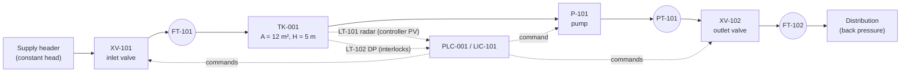

# Physics Model

The digital twin is a simplified but **closed and internally consistent** model of a water storage tank with an
inlet control valve, a transfer pump and an outlet control valve. It is not a model of any specific real plant.
Source: [`backend/app/simulation/`](../backend/app/simulation).

## Process



## Mass balance

For a constant-area tank:

```text
dV/dt = Qin − Qout − Qoverflow        V = A · h        dh/dt = (Qin − Qout) / A
```

Each physics step (Δt = 0.1 s, explicit Euler) computes volumes in m³ from flows in L/s:

```text
Vin  = Qin/1000 · Δt          Vout = Qout/1000 · Δt          V' = V + Vin − Vout
if V' < 0:      Vout = V + Vin ; V' = 0          (pump cannot remove liquid that is not there → dry running)
if V' > A·H:    Voverflow = V' − A·H ; V' = A·H  (excess leaves through the unmeasured overflow line)
h' = V' / A
```

Cumulative `cum_in`, `cum_out` and `cum_overflow` are kept, so conservation can be verified exactly:
`(V(t) − V(0)) − (Σin − Σout − Σoverflow) = 0`. The test suite checks this to < 1e-8 m³ through overflow and
complete draining, and to < 1e-9 m³ in 30 minutes of normal operation.

## Hydraulics

All pressures are gauge, in bar; flows in L/s.

| Element | Equation | Default parameters |
|---|---|---|
| Inlet valve | `Qin = Qin,max · x_in` (constant supply head, linear trim) | Qin,max = 60 L/s |
| Pump | `ΔP_pump = hf · s² · P0 − k · Q²` | P0 = 2.5 bar, k = 4·10⁻⁴ bar/(L/s)², hf = 1 (healthy) |
| Line pressure (PT-101) | `P_line = ρ g h / 10⁵ + ΔP_pump` | ρ = 998 kg/m³, g = 9.81 m/s² |
| Outlet valve | `Q = Kv · x_out · (1 − r) · √(P_line − P_back)` | Kv = 39 L/s/√bar, P_back = 0.6 bar, r = restriction |

Substituting the pump into the valve equation gives the closed form used each step:

```text
K = Kv · x_out · (1 − r)
drive = ρgh/10⁵ + hf·s²·P0 − P_back
Qout = K · √( drive / (1 + K² · k) )          (0 if drive ≤ 0)
```

Consequences that the detection rules rely on:

* With the pump stopped, `drive = ρgh/10⁵ − 0.6 < 0` for every level (max static head 0.49 bar), so **no outflow is
  possible** — a stopped pump with measured outflow is physically inconsistent.
* With the outlet closed and the pump running (dead-head), `P_line = static + P0`.
* A restriction `r` downstream of PT-101 lowers the flow *and raises* the measured pressure — the valve equation
  evaluated at the measured pressure then over-predicts the flow (PHYS-007).
* A degraded impeller (`hf < 1`) lowers pressure *and* flow together, staying consistent with the valve equation but
  not with the pump curve (PHYS-005).

Maximum rates used by PHYS-003: fill `Qin,max / A = 5.0 mm/s`; drain `Qout,max / A = 3.96 mm/s`
(`Qout,max = 47.5 L/s` at full valve, full pump, full tank).

## Actuators

* Valves move towards their command at a rated **10 %/s** (rate limiter). Commands and physical positions are separate
  state; a stuck valve keeps its physical position whatever the command.
* Pump speed follows a first-order lag (τ = 1.5 s). Power: `s³ · 1.5 kW + Q·ΔP / 0.65`.

## Instruments

Reported values are produced from physical truth by [`sensors.py`](../backend/app/simulation/sensors.py):

`reported = clamp(quantise(truth + calibration_bias + N(0, σ) + fault_offset(t)))`

| Tag | Quantity | σ (noise) | Resolution | Notes |
|---|---|---|---|---|
| LT-101 | level (radar) | 4 mm | 1 mm | controller PV |
| LT-102 | level (DP) | 5 mm | 1 mm | interlocks |
| FT-101 / FT-102 | flow (mag meter) | 0.15 L/s | 0.01 L/s | low-flow cut-off 0.2 L/s |
| PT-101 | pressure | 0.01 bar | 0.001 bar | |
| ZT-101 / ZT-102 | valve position | 0.3 % | 0.1 % | |
| JT-101 | motor power | 0.05 kW | 0.01 kW | |

Calibration biases are seeded per run (within ±0.5 σ). Every reading carries a value, unit, **source timestamp**,
quality (`good` / `uncertain` / `bad`) and validity flag. Fault types (scenario lab only): additive offset with optional
ramp, drift, step, `stuck` (value held, timestamps fresh) and `stale` (value and timestamp held).

## Controller (simulated BPCS)

* **AUTO:** PI level control on LT-101 (Kp = 8, Ki = 0.016 s⁻¹, setpoint 60 %) with 0.9× outlet-flow feed-forward,
  conditional-integration anti-windup and a 2 s PV filter. The outlet valve follows a deterministic, seeded demand
  profile (50 % ± 8 % sinusoid over 600 s plus ±10 % steps every 150 s).
* **MANUAL:** operator sets valve and pump commands directly (bumpless transfer back to AUTO).
* **Interlocks on the independent LT-102:** high level ≥ 95 % closes the inlet; low level ≤ 5 % stops the pump
  (restart ≥ 10 %).

The controller uses *reported* values exactly like a real one, which is why falsifying LT-101 drives the real process.

## Determinism

The run seed derives independent random streams for calibration biases, sensor noise and the demand profile. Two
engines with the same configuration and seed produce identical telemetry (tested); replay uses stored samples and
never re-simulates.

## Configuration

All parameters are validated Pydantic models (`SimulationConfig`) editable on the **Settings** page or via
`PUT /api/simulation/config`; changes apply through a reset into a new recorded run.
